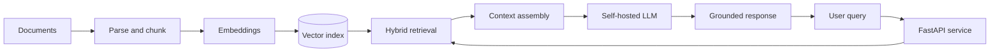

# Paul Stephen

### Backend Engineer · Applied AI Systems · Flutter

**Building reliable AI systems and high-performance backends — from architecture to production.**

Based in Bengaluru, India · Open to freelance collaborations

**[Services](#-what-i-build) · [Projects](#-featured-work) · [Architecture](#-system-design-snapshot) · [Tech](#-toolbox) · [Approach](#-how-i-work) · [Contact](#-start-a-conversation)**

---

## ⚡ Production impact

| 🎯 Ticket routing | 🚨 SLA breaches | 🔎 Document search |
| :---: | :---: | :---: |
| **71% → 97% accuracy** | **~80% reduction** | **~20 min → <10 sec** |
| 📬 Async throughput | ✅ Delivery reliability | 📊 Daily event volume |
| **5× · 1,200+ emails/min** | **95.8% → 99.7%** | **50,000+ events** |

Production outcomes reported in my professional resume. Metrics reflect distinct systems and measurements.

## 🧩 What I build

<table>
<tr><td width="50%" valign="top">

### 🤖 AI & RAG systems

Self-hosted document ingestion, OCR, chunking, hybrid retrieval, and grounded answers.

**Solves:** slow document search, repetitive review, fragmented knowledge.

</td><td width="50%" valign="top">

### 🚀 Backend performance

Profiling and tuning APIs, SQL queries, caching, async workers, and failure recovery.

**Solves:** timeouts, slow database queries, unreliable jobs.

</td></tr>
<tr><td valign="top">

### 🔌 API & service architecture

Documented REST APIs, maintainable services, reliable integrations, and observability.

**Solves:** fragile integrations and hard-to-change backends.

</td><td valign="top">

### 📱 Flutter apps

Cross-platform mobile and web apps with clear architecture and backend connectivity.

**Solves:** duplicated platform efforts and difficult app maintenance.

</td></tr>
<tr><td valign="top" colspan="2">

### ⚙️ LLM integration & automation

Use models for classification, extraction, developer tooling, and structured outputs with evaluation and deterministic fallbacks.

**Solves:** manual workflows that can be safely automated.

</td></tr>
</table>

## 🛠 Featured work

> Expand a project to explore the problem, technical approach, and outcome. Company work is summarized at a high level; public repositories are linked where available.

<b>01 · Enterprise RAG Document Platform — private production work</b> · Document search: ~20 min → &lt;10 sec

 

**Problem:** Teams searched large document collections manually.

**What I built:** A self-hosted ingestion and retrieval pipeline featuring OCR/parsing, chunking, embeddings, hybrid retrieval, FAISS, Ollama, caching, and async job orchestration.

**Reported outcome:** Under-10-second document search and **91% answer relevance** in the evaluation described in my resume.

**Stack:** `Python` `RAG` `FAISS` `Ollama` `Document processing` `Async jobs`

**Design considerations:** Private deployment, grounding, retrieval evaluation, and graceful degradation.

<b>02 · High-Throughput Async Backend — private production work</b> · 5× processing throughput

 

**Problem:** Synchronous processing restricted throughput and recovery from delivery failures.

**What I built:** Python asyncio services with retries, exponential backoff, and dead-letter queue handling.

**Reported outcome:** **200 → 1,200+ emails/min**, **50,000+ events/day**, and delivery reliability **95.8% → 99.7%**.

**Stack:** `Python` `asyncio` `Retry policies` `Dead-letter queues`

**Design considerations:** Idempotency, bounded concurrency, backpressure, and observability.

<b>03 · Agentic Codebase Analyzer — GitHub project</b> · Local developer tooling

 

A multi-stage local agent that traces repository dependencies and generates architecture summaries to accelerate codebase exploration.

**Stack:** `Python` `LangGraph` `LangChain` `Ollama` `FAISS`

[**View source code →**](https://github.com/paulsteven2329/Agentic-Codebase-Analyzer)

<b>04 · MoneyFlowX — GitHub project</b> · Offline-first finance app

 

A Flutter finance application exploring local transaction categorization, anomaly detection, and budgeting workflows.

**Stack:** `Flutter` `Dart` `ML`

[**View source code →**](https://github.com/paulsteven2329/Money-FlowX)

<b>05 · More experiments & repositories</b>

 

- [FastAPI experiments](https://github.com/paulsteven2329/FAST_API)
- [Agentic multimodal AI](https://github.com/paulsteven2329/Agentic-Multimodal-ai)
- [Generative image tooling](https://github.com/paulsteven2329/GenAI_Image_Generater)

**Additional case studies in preparation:** SQL query optimization, inference optimization, and Flutter load-time performance. Performance percentages from earlier drafts are omitted until benchmark evidence is available.

## 🏗 System design snapshot

A **conceptual reference architecture** illustrating the type of privacy-first document retrieval system I work with, **not a verbatim diagram of an employer's deployment**.

<b>Explore architecture trade-offs</b>

- **Privacy:** Run retrieval and inference locally where data sensitivity requires it.
- **Quality:** Evaluate retrieval relevance and grounded answer behavior with representative queries.
- **Latency:** Use caching and asynchronous ingestion for expensive or repeated operations.
- **Reliability:** Add fallbacks, rate limits, retries, monitoring, and operational runbooks where applicable.

## 🧰 Toolbox

| Area | Technologies and practices |
| --- | --- |
| **Backend** | Python, FastAPI, asyncio, REST, Node.js, microservices |
| **AI / ML** | RAG, embeddings, Ollama, LangChain, LangGraph, FAISS, pgvector, PyTorch |
| **Data** | PostgreSQL, MongoDB, Redis |
| **Frontend / mobile** | Flutter, Dart, React |
| **Infrastructure** | AWS, Docker, Nginx, Linux, GitHub Actions |
| **Engineering** | Caching, retries, observability, rate limiting, distributed systems |

## 🧭 How I work

**Discover:** Understand the problem and define success criteria. **Prototype:** Validate the most uncertain assumptions early. **Build:** Implement maintainable services, tests, and operational safeguards. **Measure:** Compare to the baseline. **Hand off:** Document decisions and trade-offs.

## 👤 A little about me

**AI Backend Engineer at Kinara Capital** (Feb 2024 – present). I work across ML-assisted ticket intelligence, enterprise retrieval, and asynchronous backend services.

**Education:** BCA, Kristu Jayanti College, Bengaluru (2021–2024).

## ✉️ Start a conversation

Need document search, a faster backend, AI workflow integration, or a Flutter app? Share the problem, constraints, and what success should look like.

[LinkedIn](https://www.linkedin.com/in/paul-stephen-sde1-2b974027a) · [GitHub](https://github.com/paulsteven2329) · Bengaluru, India

Made for GitHub's native Markdown renderer. Some visual elements load from shields.io; expandable sections use native GitHub-supported HTML.

